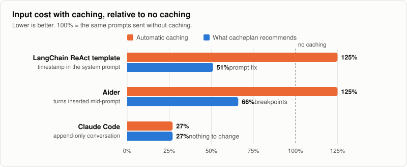
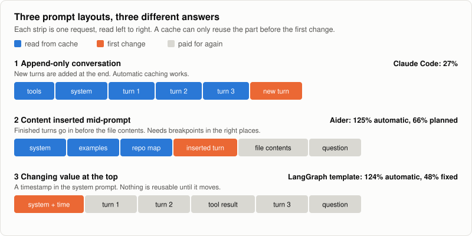

<h1 align="center">cacheplan</h1>

<p align="center">
  <b>Find out whether prompt caching will save you money, before you switch it on.</b><br>
  Diagnose your prompts, forecast every caching option, get a plan, and verify it live.
</p>

<p align="center">
  <a href="https://pypi.org/project/cacheplan/"></a>
  <a href="https://github.com/shamiksaharcciit-oss/cacheplan/actions/workflows/ci.yml"></a>
  
  
  <a href="LICENSE"></a>
</p>

<p align="center">
  
</p>

Prompt caching can cut your input bill by more than half. It can also **raise it by 25%**,
because every cache write costs extra and is wasted if nothing reads it back. Which one you
get depends on how your application assembles its prompts and how quickly requests arrive,
and neither shows up as an error.

`cacheplan` reads a log of your requests and answers three questions for each application:

| Question | What you get |
| --- | --- |
| **What is breaking my cache?** | The exact place the reusable prefix breaks, what changed there, and how many tokens you re-pay for |
| **What would each option cost?** | A forecast for caching off, automatic caching and planned breakpoints, each with the 5-minute and 1-hour lifetime |
| **What should I do?** | One recommendation with instructions, and a live check that compares the forecast with the real API |

It runs on your machine, has no dependencies, and needs no API key except for the optional
live check. **Status: early alpha, Anthropic Messages API only.**

## Contents

- [Quick start](#quick-start)
- [How it works](#how-it-works)
- [Why layout matters](#why-layout-matters)
- [Reading the report](#reading-the-report)
- [Commands](#commands)
- [Rules](#rules)
- [Use it in CI](#use-it-in-ci)
- [How accurate is the forecast?](#how-accurate-is-the-forecast)
- [Limits](#limits)
- [Related tools](#related-tools)
- [Roadmap](#roadmap)

## Quick start

**1. Install**

```
pip install --pre cacheplan
```

**2. Get a log of your requests.** If you don't have one, record it. Start the proxy:

```
cacheplan capture --out requests.jsonl --app my-app
```

Then point your application at it and use it as normal for a few minutes:

```bash
# macOS / Linux
export ANTHROPIC_BASE_URL=http://127.0.0.1:8787
```

```powershell
# Windows PowerShell
$env:ANTHROPIC_BASE_URL = "http://127.0.0.1:8787"
```

The proxy writes request bodies only. Headers never reach the file, so your API key stays
out of it.

**3. Get the verdict**

```
cacheplan report requests.jsonl
```

**4. Optional: confirm it against the real API** (one output token per request)

```
cacheplan verify requests.jsonl --model <your-model> --yes
```

## How it works

<p align="center">
  
</p>

1. **Diagnose.** Each request is compared with earlier ones from the same application to
   find where the shared prefix ends and why.
2. **Forecast.** A local model of the provider's caching rules (breakpoints, the 20-block
   lookback, lifetimes, minimum length, write and read prices) replays your log under every
   option, using the real timing between your requests.
3. **Recommend.** It picks the cheapest option, prefers the simpler one when two are within
   two points, and tells you to keep your current settings when they are already good.
4. **Verify.** Optionally, it replays the log against the live API and prints the forecast
   beside the measured result.

## Why layout matters

A cache can only reuse the part of a prompt that comes before the first change. Where that
first change falls decides everything.

<p align="center">
  
</p>

| Layout | What happens with automatic caching | What `cacheplan` suggests |
| --- | --- | --- |
| **Append-only conversation** | Works well | Nothing, or the 1-hour lifetime if your users pause a lot |
| **Content inserted mid-prompt** | Reads nothing and costs 25% more | Breakpoints just before the insertion point, learned from your log |
| **Changing value at the top** (timestamp, request id, shuffled tools) | Reads nothing and costs 25% more | Leave caching off, or move the value; the report shows what that would unlock |

## Reading the report

Real output for LangChain's ReAct agent template, abridged:

```
react-template
  17 requests, ~120,145 input tokens (estimate)
  Layout     changing content at the top of the prompt
  Reusable   2% of input tokens repeat an earlier prefix as written
  Pace       median 7 s between requests; 0% of pauses over 5 minutes

  Option                                Read  Cost vs no caching
  Caching off                             0%                100%  <- recommended
  Automatic caching, 5-minute             0%                125%
  Automatic caching, 1-hour               0%                199%
  Planned breakpoints, 5-minute           0%                100%
  Planned breakpoints, 1-hour             0%                100%
  Prompt fix + breakpoints, 5-minute     64%                 52%
  Prompt fix + breakpoints, 1-hour       64%                 79%

  Recommendation: leave caching off as the prompts stand.
  With the prompt fix in the findings: 52%. It changes what the model reads,
  so compare answer quality before adopting it.

  Findings
    CP001 system value <<system_time>> changes between requests; everything after it,
          including the conversation history, cannot be reused
        fix: move it to the latest user message, or make it change rarely
```

| Line | Meaning |
| --- | --- |
| **Layout** | Which of the three patterns above your application follows |
| **Reusable** | The ceiling: the share of input tokens that repeat an earlier prefix as your prompts stand |
| **Pace** | How fast requests arrive. Long pauses let 5-minute cache entries expire |
| **Read** | Share of input tokens the option would read from cache |
| **Cost vs no caching** | Forecast input cost, where 100% is the same prompts with caching off. Cache writes count 1.25x (5-minute) or 2x (1-hour), reads 0.1x |
| **Planned breakpoints** | `cache_control` markers placed where your log shows prefixes actually repeat, and only where a write is read back often enough to pay for itself |
| **Prompt fix** | What you would get after moving the changing values the findings point to. Shown separately because it changes the prompt |

## Commands

| Command | Use it to |
| --- | --- |
| `cacheplan report LOG` | Get the diagnosis, forecast and recommendation. Add `--json` for machines, `--no-content` to keep prompt text out of the output |
| `cacheplan diagnose LOG -v` | List every prefix break: where, what changed, tokens behind it |
| `cacheplan verify LOG --model M --yes` | Replay against the live API and compare forecast with measured |
| `cacheplan gaps LOG` | See how the forecast changes as pauses between requests grow |
| `cacheplan check LOG --min-reusable 0.5` | Fail a pipeline when too little of the prompt is reusable |
| `cacheplan capture --out LOG` | Record requests through a local proxy |
| `cacheplan rules` | List rule ids |

Useful options:

- `--learn-from OTHER.jsonl` learns the breakpoint plan from one log and scores another, so
  the forecast is out of sample.
- `--min-tokens N` sets the minimum cacheable prompt length for your model (default 1,024).
- `--fail-on CP001,CP002` makes `report` exit with status 1 when those findings appear.

**Log formats.** One JSON object per line, and formats can be mixed in one file: a
`cacheplan capture` line, a raw Anthropic request body, or a
[promptcachelint](https://github.com/OsmnvAslan/promptcachelint) trace record.

## Rules

| Rule | Finding | Typical fix |
| --- | --- | --- |
| `CP001` | A value in the system prompt or tools changes between requests | Move it to the latest user message, or make it change rarely |
| `CP002` | Tool definitions are sent in a different order | Build the tool list in a fixed order |
| `CP003` | Caching is not switched on | Follow the recommendation |
| `CP004` | Prompts are shorter than the minimum cacheable length | Nothing to do |
| `CP005` | A per-tenant or per-user value sits before static content | Move it behind the static instructions |
| `CP006` | New content is inserted before content that was already sent | Use the planned breakpoints, or append new turns at the end |
| `CP007` | Previously sent message content changes between requests | Keep earlier messages identical; send changing material late |
| `CP008` | Many pauses are longer than the 5-minute cache lifetime | Compare the 1-hour rows |
| `CP009` | Cache writes are rarely read back with the current settings | Follow the recommendation |

## Use it in CI

Record a short session in your test suite, then guard against changes that break the cache:

```yaml
- run: pip install --pre cacheplan
- run: cacheplan check captures/session.jsonl --min-reusable 0.5
- run: cacheplan report captures/session.jsonl --fail-on CP001,CP002 --no-content
```

One developer adding a timestamp to the system prompt can silently undo a cache saving.
This catches it in the pull request.

## How accurate is the forecast?

Every forecast below was checked with `cacheplan verify` against the live API on
23 November 2026 (one model, short sessions).

| Application | Option | Forecast | Measured |
| --- | --- | --- | --- |
| LangChain ReAct agent template | Automatic caching, 5-minute | 125% | 125% |
| LangChain ReAct agent template | Prompt fix + breakpoints, 5-minute | 52% | 51% |
| Aider | Planned breakpoints, 5-minute | 63% | 62% |
| Aider | Planned breakpoints, 1-hour | 91% | 90% |
| Aider | Aider's own caching (`--cache-prompts`) | 65% | 64% |

For Aider, the breakpoint plan was learned from one session and scored on a different one,
and it matched Aider's hand-tuned caching. Claude Code was at its ceiling already (27%,
local model only), and `cacheplan` correctly recommended changing nothing.

## Limits

- **Small evidence base.** Three applications, one or two short sessions each, one model.
- **The forecast is a model.** It follows the documented caching rules and estimates tokens
  at three characters each. Run `verify` before acting on a close call.
- **Minimum cacheable length varies by model.** Set `--min-tokens` for yours.
- **The prompt fix changes what the model reads.** It never drops content, but its effect on
  answer quality is not measured. Implement and test it yourself.
- **Plans are learned from the log you give it.** A short or unrepresentative log gives a
  poor plan. Use `--learn-from` to test on a second log.
- **Savings apply to input tokens only.** Output tokens are unaffected.
- **Anthropic only** in this release.

## Related tools

[promptcachelint](https://github.com/OsmnvAslan/promptcachelint) and
[cachelint](https://github.com/Diafyx/cachelint) explain why a prompt cache missed, and both
support OpenAI as well as Anthropic. If you only need miss diagnosis, or you use OpenAI, look
at them first.

| | promptcachelint | cachelint | cacheplan |
| --- | :---: | :---: | :---: |
| Find where the prefix breaks | Yes | Yes | Yes |
| Flag timestamps and similar | Yes | Yes | Yes |
| OpenAI support | Yes | Yes | Not yet |
| In-process SDK recording | Yes | Yes | Not yet (proxy) |
| Forecast cost for each caching option | | | Yes |
| Plan where to place breakpoints | | | Yes |
| Recommend off, 5-minute or 1-hour | | | Yes |
| Verify against the live API | | | Yes |

Comparison made on 23 November 2026 against promptcachelint 0.1.0 and cachelint 0.3.0a1.

## Roadmap

- Read usage counters from recorded responses, so forecasts can be checked on any log
- In-process recording through the SDK's HTTP client
- OpenAI and other providers
- Baselines and regression policies for CI
- A shareable HTML report

## Development

```
git clone https://github.com/shamiksaharcciit-oss/cacheplan
cd cacheplan
pip install -e ".[dev]"
python -m pytest -q
```

Issues and pull requests are welcome, especially logs (with content removed) from
applications where the forecast and the live result disagree.

Licence: [Apache-2.0](LICENSE).
