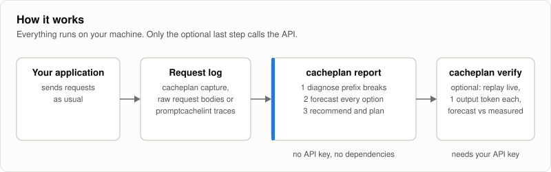

<h1 align="center">cacheplan</h1>

<p align="center">
  <b>Find out whether prompt caching will save you money, before you switch it on.</b><br>
  Diagnose your prompts, forecast every caching option, get a plan, and verify it live.
</p>

<p align="center">
  <a href="https://pypi.org/project/cacheplan/"></a>
  <a href="https://github.com/shamiksaharcciit-oss/cacheplan/actions/workflows/ci.yml"></a>
  
  
  <a href="LICENSE"></a>
</p>

<p align="center">
  
</p>

<p align="center"><sub>LangGraph ReAct template: from the <a href="#benchmark-six-agent-starters">benchmark</a> below. Aider and Claude Code: separate captures of real coding sessions, described under <a href="#how-accurate-is-the-forecast">How accurate is the forecast?</a> Claude Code's figure is a local forecast, not measured.</sub></p>

Prompt caching can cut your input bill by more than half. It can also **raise it by 25%**,
because every cache write costs extra and is wasted if nothing reads it back. Which one you
get depends on how your application assembles its prompts and how quickly requests arrive,
and neither shows up as an error.

`cacheplan` reads a log of your requests and answers three questions for each application:

| Question | What you get |
| --- | --- |
| **What is breaking my cache?** | The exact place the reusable prefix breaks, what changed there, and how many tokens you re-pay for |
| **What would each option cost?** | A forecast for caching off, automatic caching and planned breakpoints, each with the 5-minute and 1-hour lifetime |
| **What should I do?** | One recommendation with instructions, and a live check that compares the forecast with the real API |

It runs on your machine, has no dependencies, and needs no API key except for the optional
live check. **Status: early alpha.** The Anthropic API is checked against live traffic; OpenAI,
Bedrock and Gemini logs are read too, with [limits](#providers).

## Contents

- [Quick start](#quick-start)
- [How it works](#how-it-works)
- [Why layout matters](#why-layout-matters)
- [Reading the report](#reading-the-report)
- [Commands](#commands)
- [Providers](#providers)
- [Rules](#rules)
- [Use it in CI](#use-it-in-ci)
- [Benchmark: six agent starters](#benchmark-six-agent-starters)
- [How accurate is the forecast?](#how-accurate-is-the-forecast)
- [Limits](#limits)
- [Related tools](#related-tools)
- [Roadmap](#roadmap)

## Quick start

**1. Install**

```
pip install --pre cacheplan
```

**2. Get a log of your requests.** If you don't have one, record it. Start the proxy:

```
cacheplan capture --out requests.jsonl --app my-app
```

Then point your application at it and use it as normal for a few minutes:

```bash
# macOS / Linux
export ANTHROPIC_BASE_URL=http://127.0.0.1:8787
```

```powershell
# Windows PowerShell
$env:ANTHROPIC_BASE_URL = "http://127.0.0.1:8787"
```

The proxy writes request bodies and token counts. Headers never reach the file, so your API
key stays out of it.

> **The log holds everything your application sends to the model:** system prompts, user
> messages, tool definitions, file contents. Check it before you share or commit it. To
> keep prompt text out of the file altogether, capture with `--no-content`: every word is
> replaced by scrambled characters of the same length, using a key that is never stored.
> Reports still work on such a log, with the same costs and findings but no readable
> examples, and it cannot be replayed with `verify` or `quality`.

**3. Get the verdict**

```
cacheplan report requests.jsonl
```

**4. Optional: confirm it against the real API** (one output token per request)

```
cacheplan verify requests.jsonl --model <your-model> --yes
```

## How it works

<p align="center">
  
</p>

1. **Diagnose.** Each request is compared with earlier ones from the same application to
   find where the shared prefix ends and why.
2. **Forecast.** A local model of the provider's caching rules (breakpoints, the 20-block
   lookback, lifetimes, minimum length, write and read prices) replays your log under every
   option, using the real timing between your requests.
3. **Recommend.** It picks the cheapest option, prefers the simpler one when two are within
   two points, and tells you to keep your current settings when they are already good.
4. **Verify.** Optionally, it replays the log against the live API and prints the forecast
   beside the measured result.

## Why layout matters

A cache can only reuse the part of a prompt that comes before the first change. Where that
first change falls decides everything.

<p align="center">
  
</p>

| Layout | What happens with automatic caching | What `cacheplan` suggests |
| --- | --- | --- |
| **Append-only conversation** | Works well | Nothing, or the 1-hour lifetime if your users pause a lot |
| **Content inserted mid-prompt** | Reads nothing and costs 25% more | Breakpoints just before the insertion point, learned from your log |
| **Changing value at the top** (timestamp, request id, shuffled tools) | Reads nothing and costs 25% more | Leave caching off, or move the value; the report shows what that would unlock |

## Reading the report

Real output for the LangGraph ReAct agent template, abridged:

```
react-template
  17 requests, ~120,145 input tokens (estimate)
  Layout     changing content at the top of the prompt
  Reusable   2% of input tokens repeat an earlier prefix as written
  Pace       median 7 s between requests; 0% of pauses over 5 minutes

  Option                                Read  Cost vs no caching
  Caching off                             0%                100%  <- recommended
  Automatic caching, 5-minute             0%                125%
  Automatic caching, 1-hour               0%                199%
  Planned breakpoints, 5-minute           0%                100%
  Planned breakpoints, 1-hour             0%                100%
  Prompt fix + breakpoints, 5-minute     64%                 52%
  Prompt fix + breakpoints, 1-hour       64%                 79%

  Recommendation: leave caching off as the prompts stand.
  With the prompt fix in the findings: 52%. It changes what the model reads,
  so compare answer quality before adopting it.

  Findings
    CP001 system value <<system_time>> changes between requests; everything after it,
          including the conversation history, cannot be reused
        fix: move it to the latest user message, or make it change rarely
```

| Line | Meaning |
| --- | --- |
| **Layout** | Which of the three patterns above your application follows |
| **Reusable** | The ceiling: the share of input tokens that repeat an earlier prefix as your prompts stand |
| **Pace** | How fast requests arrive. Long pauses let 5-minute cache entries expire |
| **Read** | Share of input tokens the option would read from cache |
| **Cost vs no caching** | Forecast input cost, where 100% is the same prompts with caching off. Cache writes count 1.25x (5-minute) or 2x (1-hour); reads count 0.1x on most models and less on some, looked up from the model in your log |
| **This log** | The same forecast in money, when the model's price is known or `--price` is given |
| **Planned breakpoints** | `cache_control` markers placed where your log shows prefixes actually repeat, and only where a write is read back often enough to pay for itself |
| **Prompt fix** | What you would get after moving the changing values the findings point to. Shown separately because it changes the prompt |

## Commands

| Command | Use it to |
| --- | --- |
| `cacheplan report LOG` | Get the diagnosis, forecast and recommendation. Add `--json` for machines, `--no-content` to keep prompt text out of the output |
| `cacheplan diagnose LOG -v` | List every prefix break: where, what changed, tokens behind it |
| `cacheplan verify LOG --model M --yes` | Replay against the live API and compare forecast with measured |
| `cacheplan gaps LOG` | See how the forecast changes as pauses between requests grow |
| `cacheplan check LOG --min-reusable 0.5` | Fail a pipeline when too little of the prompt is reusable |
| `cacheplan quality LOG --model M --yes` | Check whether the prompt fix changes the model's answers, against a control |
| `cacheplan baseline LOG --save FILE` / `--compare FILE` | Save a content-free summary and fail later runs that are worse |
| `cacheplan capture --out LOG` | Record requests and their token usage through a local proxy. `--provider openai` or `gemini` for those APIs; `--no-content` scrambles prompt text |
| `cacheplan rules` | List rule ids |

Useful options:

- `--learn-from OTHER.jsonl` learns the breakpoint plan from one log and scores another, so
  the forecast is out of sample.
- `--model ID` or `--min-tokens N` sets the minimum cacheable prompt length when the log does
  not name the model. Otherwise it is looked up per request.
- `--fail-on CP001,CP002` makes `report` exit with status 1 when those findings appear.
- `--price N` sets the input price in USD per million tokens; by default it is looked up from the model.
- `--html report.html` also writes a self-contained page you can forward.

**Log formats.** One JSON object per line, and formats can be mixed in one file: a
`cacheplan capture` line, a raw request body (Anthropic Messages, OpenAI Chat Completions or
Responses, Bedrock Converse, Gemini generateContent), or a
[promptcachelint](https://github.com/OsmnvAslan/promptcachelint) trace record. The provider
is detected per line.

### Real token counts

Token counts are estimated from characters unless the log holds the provider's own numbers.
`cacheplan capture` and the in-process recorder both store the usage block of every
response (never the response text). When a log has it, `report`:

- calibrates its token estimate on your own traffic, including the tokens the API adds for
  tool use;
- prints a **forecast check**: what it predicted for the settings you ran with, next to what
  the provider actually billed. No extra API calls are needed.

### Record from inside your application

No proxy needed: wrap the HTTP transport of the Anthropic SDK client.

```python
import anthropic
from cacheplan.record import RecordingTransport

client = anthropic.Anthropic(http_client=anthropic.DefaultHttpxClient(
    transport=RecordingTransport("requests.jsonl", app="my-app")))
```

Use `AsyncRecordingTransport` with `anthropic.DefaultAsyncHttpxClient` for the async client.
Headers and response text are never written; pass `no_content=True` to scramble prompt text
too. The same transport works for the OpenAI SDK
(`openai.OpenAI(http_client=openai.DefaultHttpxClient(transport=...))`). For Bedrock:

```python
import boto3
from cacheplan.record import record_bedrock

client = record_bedrock(boto3.client("bedrock-runtime"), "requests.jsonl", app="my-app")
```

## Providers

Every request is converted to one internal shape, so diagnosis and findings work the same
everywhere. What differs is how much of the forecast each provider's documentation supports.

| Provider | Diagnosis and findings | Cost forecast | Options compared | Checked against the live API |
| --- | :---: | :---: | --- | :---: |
| Anthropic API | Yes | Yes | Off, automatic, planned breakpoints, prompt fix; 5-minute and 1-hour | Yes |
| Bedrock, Claude models (Converse, InvokeModel) | Yes | Yes | Same as Anthropic, as `cachePoint` blocks; Bedrock's own minimums | No |
| Bedrock, Nova | Yes | Yes, set `--price` | Off, planned breakpoints; 5-minute only | No |
| OpenAI, GPT-5.6 and later | Yes | Yes | Off, automatic, planned breakpoints, prompt fix; 30-minute and 12-hour; writes at 1.25x and 2.5x | Two runs, automatic mode |
| OpenAI, GPT-5.5 and earlier | Yes | Yes | Automatic only (no write fee, nothing to switch on), prompt fix; in-memory and 24h retention | One run |
| Gemini | Yes | No | None | No |

What to know before relying on the non-Anthropic rows:

- **Only one of them has been compared with a live API, once.** On 23 November 2026 a
  15-request append-only run on `gpt-5.4-mini` (`benchmarks/providers/openai_driver.py`) was
  forecast at 19% of the uncached input cost and billed at 21%. A second run with a
  timestamp in the system prompt was forecast at 23% and billed at 17%; the cache was still
  warm from the first run, which accounts for the gap (15 reads instead of the 14 a cold
  start gives). On `gpt-5.6-luna` the first forecast was wrong (34% against 19% billed): a
  cache write there also makes every earlier message ending readable, so a new conversation
  reuses the shared system message. The rule was corrected from that run and now gives 19%
  on it. A separate run with a timestamp in the system prompt then confirmed it
  independently: forecast 125%, billed 125%, nothing read. On these models the default
  automatic caching costs more than no caching when the system message changes every
  request. Breakpoints and the 12-hour
  lifetime on these models, Bedrock and Gemini are untested.
  The rules were read from each provider's documentation on the same day. If your log has recorded usage,
  the report's forecast check tells you how well the model holds on your own traffic; treat
  the forecast as unconfirmed until you have seen that line.
- **OpenAI, GPT-5.5 and earlier:** the cache keeps any shared prefix, in fixed token steps,
  so a changing value late in the system prompt costs less than it does on Anthropic. Cache
  lifetimes are the typical values OpenAI documents, not guarantees, and requests are
  assumed to reach the same cache (set `prompt_cache_key` if your traffic is high).
- **Gemini:** its documentation does not state the cached-token discount or how long
  implicit caches live, so there is no cost forecast. Explicit caches (`cachedContents`) are
  not modelled.
- **Bedrock, Claude models:** Anthropic's prices are assumed. Check your Bedrock rates and
  pass `--price` if they differ. InvokeModel bodies do not name the model; pass `--model`.
- `verify` and `quality` send requests to the Anthropic API only.
- Applications from other providers are labelled, for example `my-app [openai]`.

## Rules

| Rule | Finding | Typical fix |
| --- | --- | --- |
| `CP001` | A value in the system prompt or tools changes between requests | Move it to the latest user message, or make it change rarely |
| `CP002` | Tool definitions are sent in a different order | Build the tool list in a fixed order |
| `CP003` | Caching is not switched on | Follow the recommendation |
| `CP004` | Prompts are shorter than the minimum cacheable length | Nothing to do |
| `CP005` | A per-tenant or per-user value sits before static content | Move it behind the static instructions |
| `CP006` | New content is inserted before content that was already sent | Use the planned breakpoints, or append new turns at the end |
| `CP007` | Previously sent message content changes between requests | Keep earlier messages identical; send changing material late |
| `CP008` | Many pauses are longer than the short cache lifetime | Compare the long-lifetime rows |
| `CP009` | Cache writes are rarely read back with the current settings | Follow the recommendation |

## Use it in CI

Record a short session in your test suite, then guard against changes that break the cache.
As a GitHub Action:

```yaml
- uses: actions/setup-python@v7
  with:
    python-version: "3.12"
- uses: shamiksaharcciit-oss/cacheplan@v0.3.0a1
  with:
    log: captures/session.jsonl
    min-reusable: "0.5"
    fail-on: CP001,CP002
    baseline: captures/baseline.json   # optional, from `cacheplan baseline --save`
```

The report is added to the job summary without prompt text. Or call the commands directly:

```yaml
- run: pip install cacheplan==0.3.0a1
- run: cacheplan check captures/session.jsonl --min-reusable 0.5
- run: cacheplan baseline captures/session.jsonl --compare captures/baseline.json
```

One developer adding a timestamp to the system prompt can silently undo a cache saving.
This catches it in the pull request.

## Benchmark: six agent starters

The same three conversations through each framework's default agent, captured on 23 November
2026 and measured on the live Anthropic API with cacheplan 0.3.0a1 (`claude-sonnet-5-5`, cache
reads at 0.05x an input token). Input cost is relative to the same requests without
caching. Scripts and method: [`benchmarks/frameworks`](benchmarks/frameworks).

| Framework | Version | As shipped | Automatic caching | Best option measured | Finding |
| --- | --- | --- | --- | --- | --- |
| smolagents `ToolCallingAgent` | 1.26.0 | 100% (caching off) | 36% | 32% planned breakpoints | Caching off |
| LangChain `create_agent` | 1.5.2 | 100% (caching off) | 42% | 42% automatic | Caching off |
| Anthropic SDK tool loop | 2.13.0 | 100% (caching off) | 43% | 43% automatic | Caching off |
| Pydantic AI `Agent` | 2.71.0 | 100% (caching off) | 45% | 45% automatic | Caching off |
| CrewAI `Agent` | 1.15.44 | 89% (caches by default) | 97% | 89% as shipped | Short prompts |
| LangGraph ReAct template | langgraph 1.2.24 | 100% (caching off) | 124% | 48% after moving the timestamp | Timestamp in the system prompt ([issue](https://github.com/langchain-ai/react-agent/issues/123)) |

Five of the six ship with caching off. For four of them, switching it on cuts the input
bill by more than half. For one it raises the bill, and `cacheplan` says why.

## How accurate is the forecast?

Forecasts checked against the live API. The first nine rows were all produced by cacheplan
0.3.0a1 on 24 November 2026 (`bench.py verify`, `claude-sonnet-5-5`, short sessions):

| Application | Option | Forecast | Measured |
| --- | --- | --- | --- |
| LangGraph ReAct template | Automatic caching, 5-minute | 124% | 124% |
| LangGraph ReAct template | Prompt fix + breakpoints, 5-minute | 50% | 48% |
| Anthropic SDK tool loop | Automatic caching, 5-minute | 43% | 43% |
| LangChain `create_agent` | Automatic caching, 5-minute | 42% | 42% |
| Pydantic AI `Agent` | Automatic caching, 5-minute | 44% | 45% |
| smolagents `ToolCallingAgent` | Automatic caching, 5-minute | 36% | 36% |
| smolagents `ToolCallingAgent` | Planned breakpoints, 5-minute | 32% | 32% |
| CrewAI `Agent` | CrewAI's own caching | 90% | 89% |
| CrewAI `Agent` | Automatic caching, 5-minute | 97% | 97% |

All nine are within two points; the largest gap is the LangGraph prompt fix. Two things keep
this from being stronger evidence than it looks. The breakpoint plans and the prompt fix
were learned on the same captures they are scored on. And the character-to-token ratio the
forecast uses was tuned on the CrewAI capture after 0.1.0a1 missed it by ten points, so the
CrewAI rows show that the miss is repaired, not that it was predicted. Prompts near the
minimum cacheable length remain the least reliable case, and the report warns when that
applies.

Aider is the out-of-sample case: the breakpoint plan was learned from one coding session
and scored on a different one (`verify --learn-from`, same version, same day):

| Application | Option | Forecast | Measured |
| --- | --- | --- | --- |
| Aider, main prompt | Automatic caching, 5-minute | 125% | 125% |
| Aider, main prompt | Planned breakpoints, 5-minute | 64% | 63% |
| Aider, main prompt | Planned breakpoints, 1-hour | 81% | 80% |

Aider's own hand-tuned caching (`--cache-prompts`) measured 64% on a third session with
cacheplan 0.1.0a1, which priced cache reads at twice the published rate, so the true figure
is about two points lower. The learned plan is therefore close to the hand-tuned one, not
shown to beat it. Claude Code was at its ceiling already (27%, local forecast only, never
measured), and `cacheplan` recommended changing nothing.

## Limits

- **Small evidence base.** Eight applications, one or two short sessions each, one model.
- **The forecast is a model.** It follows the documented caching rules. Tokens are estimated
  from characters unless the log has recorded usage, in which case the estimate is calibrated
  on it. Run `verify` before acting on a close call.
- **Minimum cacheable length varies by model.** It is looked up from the model in your log; set
  `--model` or `--min-tokens` if the log does not name one. Forecasts for prompts close to the
  minimum are rough.
- **The prompt fix changes what the model reads.** It never drops content. `cacheplan quality`
  compares answers with and without it against a control, on actions taken and wording; that
  is a screen, not a full evaluation, and it has only been tested against a stand-in so far.
- **Plans are chosen by replaying the log you give it,** with its real timing, separately
  for each cache lifetime. A short or unrepresentative log gives a poor plan. Use
  `--learn-from` to test on a second log.
- **Prices and minimums are a snapshot** of each provider's documentation on 23 November 2026.
- **Savings apply to input tokens only.** Output tokens are unaffected.
- **Only the Anthropic API has been checked live.** See [Providers](#providers) for what is
  and is not forecast elsewhere.

## Related tools

[promptcachelint](https://github.com/OsmnvAslan/promptcachelint) and
[cachelint](https://github.com/Diafyx/cachelint) explain why a prompt cache missed, and both
support OpenAI as well as Anthropic. If you only need miss diagnosis, look at them first.

| | promptcachelint | cachelint | cacheplan |
| --- | :---: | :---: | :---: |
| Find where the prefix breaks | Yes | Yes | Yes |
| Flag timestamps and similar | Yes | Yes | Yes |
| OpenAI support | Yes | Yes | Yes, not yet checked live |
| In-process SDK recording | Yes | Yes | Yes |
| Forecast cost for each caching option | | | Yes |
| Plan where to place breakpoints | | | Yes |
| Recommend off, 5-minute or 1-hour | | | Yes |
| Verify against the live API | | | Yes |

Comparison made on 23 November 2026 against promptcachelint 0.1.0 and cachelint 0.3.0a1.

## Roadmap

- Read Langfuse, LangSmith, OpenTelemetry and LiteLLM exports
- Live verification for OpenAI and Bedrock; a Gemini forecast once its rules are documented
- A wrapper that applies the plan automatically, once the quality check has more evidence
- Longer sessions and more frameworks in the benchmark

## Development

```
git clone https://github.com/shamiksaharcciit-oss/cacheplan
cd cacheplan
pip install -e ".[dev]"
python -m pytest -q
```

Issues and pull requests are welcome, especially logs (with content removed) from
applications where the forecast and the live result disagree.

Licence: [Apache-2.0](LICENSE).
